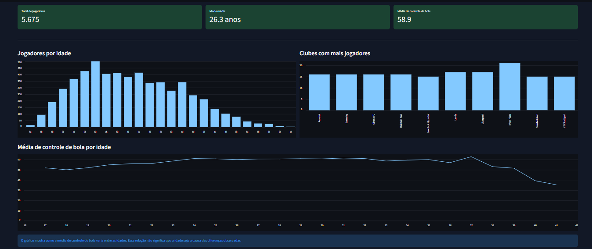
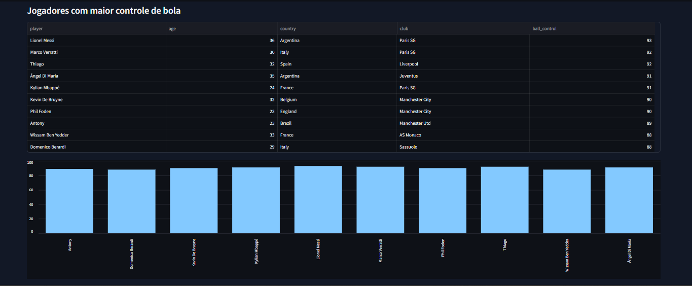

# Football Data Insights

## Sobre o projeto

Projeto de análise exploratória de dados de jogadores do FIFA 24, desenvolvido em Python. O objetivo é explorar características dos jogadores e apresentar os resultados por meio de estatísticas, gráficos e um dashboard interativo.

## Análises realizadas

- Quantidade de jogadores por país e idade;
- Distribuição de jogadores por clube;
- Ranking dos 10 jogadores com maior controle de bola;
- Cálculo da idade média dos jogadores;
- Cálculo da média de controle de bola;
- Análise da relação entre idade e controle de bola;
- Filtros interativos por país e faixa etária.

## Tecnologias utilizadas

- Python
- Pandas
- Matplotlib
- Streamlit

## Visualização do dashboard

### Visão geral



### Ranking dos jogadores com maior controle de bola



## Base de dados

O projeto utiliza o dataset [FIFA 24 Player Stats](https://www.kaggle.com/datasets/rehandl23/fifa-24-player-stats-dataset), que contém informações sobre jogadores, clubes, países, idades e atributos técnicos.

Para executar o projeto, baixe o dataset na fonte original e coloque o arquivo `player_stats.csv` na mesma pasta dos scripts Python.

O arquivo de dados não está incluído neste repositório.

## Como executar

### 1. Instalar as dependências

```bash
pip install -r requirements.txt
```

### 2. Executar a análise exploratória

```bash
python analise.py
```

### 3. Executar o dashboard interativo

```bash
python -m streamlit run dashboard.py
```

O dashboard será aberto no navegador.

Certifique-se de que o arquivo `player_stats.csv` esteja na mesma pasta dos scripts Python.

## Status do projeto

Análise exploratória e dashboard desenvolvidos. Melhorias e publicação online planejadas.